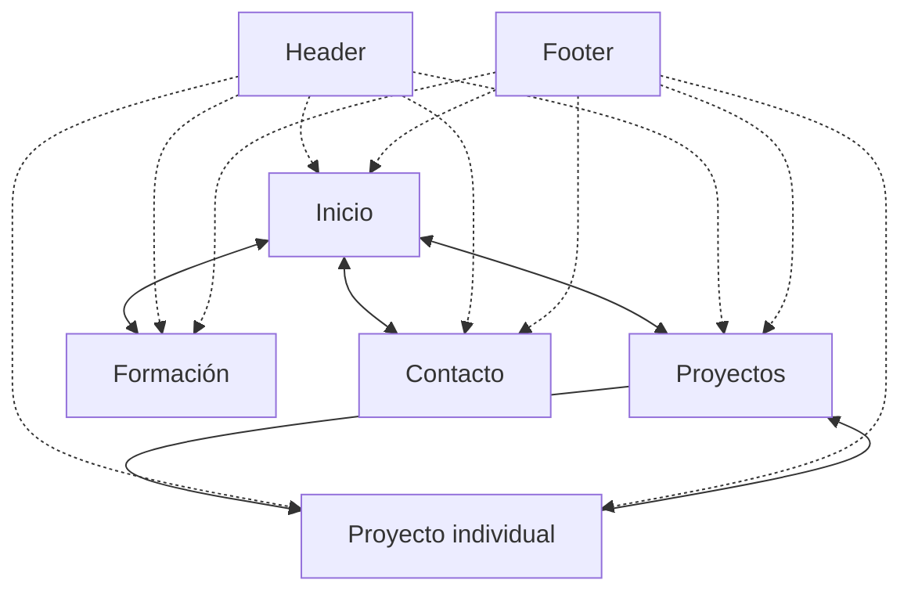

# Portfolio personal
Portfolio personal maquetado con HTML y CSS a mano, acompañado de funcionalidades realizadas con JavaScript, donde mostrar mis proyectos y capacidades como programador.

## Estructura del proyecto
El portfolio está compuesto por cinco páginas principales, conectadas mediante un sistema de navegación común:

## ¿Qué páginas contiene?
- Página de inicio, donde se me presenta y se muestran distintas competencias personales. Entre las que se encuentran varios de mis proyectos realizados y competencias adquiridas durante mi trayectoria.
- Página de proyectos, donde se muestran mis diferentes proyectos creados y, los que actualmente se están desarrollando. Se muestran a modo de "tarjeta" con una descripción breve, una imagen que lo acompaña y las tecnologías que contiene.
- Página de proyectos individuales, donde se amplia la información de cada proyecto al darle clic sobre uno en la página proyectos (de momento se muestra siempre el mismo proyecto a falta de un js que lo resuelva dinámicamente). En ella se detalla el proyecto seleccionado con más amplitud: una imagen mayor con más detalle, el año de creación, su enlace al repositorio de GitHub, la información detallada de por que se hizo y para que sirve y sus diferentes utilidades.
- Página de formación, donde se muestra un "resumen" de mi curriculum vitae, especificando formaciones académicas, experiencia profesional, cursos y certificaciones y habilidades técnicas, con un enlace de descarga a mi CV original.
- Página de contacto, donde se muestra un agradecimiento por visitar la página y se incita al visitante a contactar conmigo como interés laboral, dejando diferentes enlaces de contacto a disposición.

## Elementos comunes
Todas las páginas tienen un header fijado en la parte superior con los enlaces de navegación a las diferentes páginas y un enlace de descarga a mi CV.

Además, también tienen un footer en la parte inferior de cada página donde, también, se muestran los enlaces de navegación y  también algunos enlaces de contacto. Ambos elementos contienen una imagen personal y mi nombre.